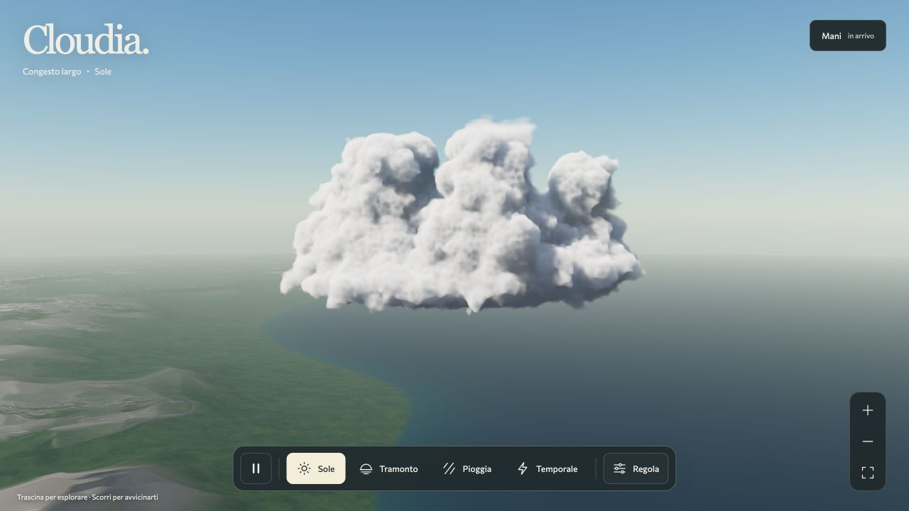

# Sole in movimento: prima misura di 90 secondi

16 ottobre 2026. Renderer v40 del checkpoint `a1efb8e`, senza modifiche ai
sorgenti. **Cadenza vicina a 60 invii/s in questa vista; obiettivo globale aperto.**

| Metrica | Risultato |
| --- | ---: |
| Intervalli / durata misurata | 5.395 / 90.005,9 ms |
| Frequenza di invio | 59,9405/s |
| Mediana / p95 / p99 | 16,7 / 18,6 / 18,7 ms |
| Massimo intervallo | 51,7 ms |
| Intervalli oltre 33,34 ms | 2 |
| Frequenza limitata dal completamento del prefisso | 59,9323/s |
| Chiusura finale del prefisso | 4,4 ms |
| Latenza dei 89 campioni periodici del prefisso | 9,1–15,4 ms |
| Somma diagnostica dei pass GPU, media / p95 | 20,800 / 25,559 ms |

Configurazione effettiva: Apple `metal-3`, main, diagnostica `stages`, qualità
Massima / 384 passi nominali, macro 256³ e dettaglio 128³, output e interno
2560×1440, CSS 1280×720, DPR 2. Nessuna ablation o risoluzione adattiva.
Vista ordinaria, senza camera di confronto: seed 72, congestus, Sole,
vento 0,55, pioggia e dispersione 0, pausa disattivata e camera ferma.
Il tempo della nube passa da 76,405 a 168,426 s nei metadati che includono
anche i 2 s di riscaldamento. La scena è in moto; la camera non lo è.

Tutti i prefissi iniziale, periodici e finale risultano completati; quello
finale conferma 5.395 invii misurati. Non emerge un aumento delle latenze nei
campioni periodici. Il massimo di 61 draw non ancora confermati a JavaScript
include la distanza di un secondo fra campioni: **non indica una coda fisica
di 61 frame**. La frequenza limitata dal completamento comprende anche tempi
di notifica JavaScript e lavoro eventualmente ereditato prima della finestra.

La media GPU è una somma sparsa dei pass campionati, non la latenza completa
del frame né il reciproco degli FPS. La presentazione del compositor resta
non misurata: `presentedCanvasFps:null`. Due intervalli oltre 33,34 ms impediscono
di descrivere la prova come assenza di scatti. Questa singola esecuzione non
qualifica tutte le famiglie, il controluce, l'avvicinamento o la pioggia.

Non sono stati richiesti screenshot nella finestra misurata. Le immagini sono
successive al completamento; l'anteprima è poi rimasta animata. Nessun altro
benchmark GPU o bake di volume avviato dagli agenti in parallelo; sistema
operativo e altre applicazioni non sono controllati. Console senza warning
o errori. Quattro hash dei bundle app, worker e hero coincidono con quelli
del checkpoint precedente; la suite 163/28 non è stata ripetuta su sorgenti
identici per questo aggiornamento delle sole evidenze.

[Report grezzo, geometria DOM, console, immagini e verifica SHA](measurements/fps-sun-motion-2026-10-16/verification.json).

