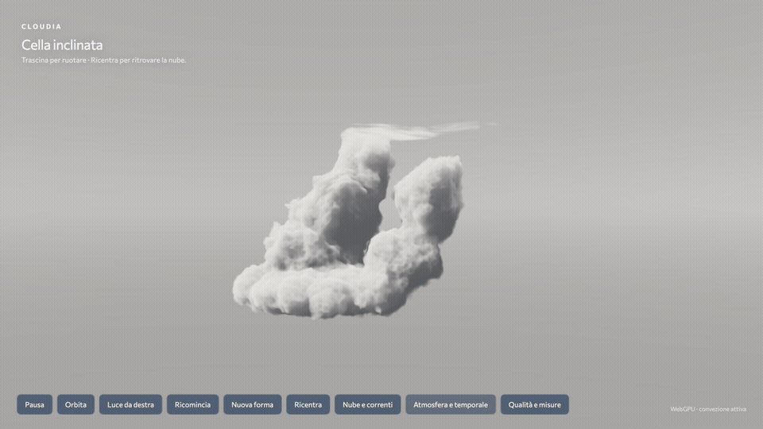

# Cloudia: morphology, storm circulation and interaction

Date: 2026-10-13. Base `55405f5`; feature branch `codex/cumulonimbus-webgpu`. Renderer identifier `morphology-flow-v14`. Owner requested improved realism, changing cloud forms, two-axis drag/recenter, wind/up/down flow, a nonblue background, gesture-ready dispersion, animated preview, GitHub publication and a manual office handoff.

## Visible changes

| Change | Implementation | Practical limit |
| --- | --- | --- |
| Three different forms | `seed % 3` selects broad congestus, multicell towers or a sheared cell. New-form cycles family and chooses a fresh uint32 seed; explicit family selection stays in that family | Authored anatomical variation; not a distribution of observed storm measurements |
| Broader proportions and attached cap | Lower bases, unequal turret sites, replenished overlapping necks, protected dense interiors; thicker proximal sheared cap and tapered streaks | Static anatomy is baked once; photographic ice microstructure still needs refinement |
| Rising and descending cues | Five compact thermals with independent periods, peripheral roll/entrainment, a separate offset sinking lobe and upper outflow in16³ compute | A bounded displacement field, not integrated velocity, pressure, moisture or precipitation |
| Shear/advection | Seeded leaning anatomy plus height-dependent inverse wind transform; density/detail/cached light share coordinates. Whole-cloud drift adds slower movement | Accelerated uncalibrated units. Cached optical depth is approximate under nonrigid deformation |
| Dispersion/renewal | Smooth transport broadening, detail-dependent erosion/fragments, reduced density and scaled cached optical depth. Transient 3.5s burst automatically recovers; held slider and Ricondensa are separate controls | No mass/water conservation. Partial dispersion changes illumination approximately |
| Camera | Pointer capture, yaw/pitch drag with limits, keyboard arrows/Home; Ricentra aims at seeded support/current drift without resetting weather | No zoom or full trackball roll; those were not requested |
| Overcast background | Neutral overcast radiance LUT and matching ambient color are default. Clear/haze remain selectable | Authored surrounding overcast illumination; no terrain or background cloud layers |
| Internal lightning | Seeded bent four-point channel with a branch, volumetric local/diffuse illumination, irregular short pulses and existing distance-delayed thunder | Does not simulate charge separation/leaders or cloud-to-ground bolts |
| Future hands | Public `applyWeatherImpulse` dispatches gust/disperse/condense/lightning through the same main/worker protocol | No camera permission, hand inference or gesture recognition added in this session |

Fixed 256³ macro,128³ detail and 384 nominal integration steps retained. No dependency added, external source copied, TAA or adaptive resolution introduced. Legacy WebGL/hero and Commissioner remain intact.

## Corrections found during verification

Initial v14 browser view showed fragmented tower necks and a weak cap. Extra overlapping neck support and interior protection now keep replenished cores connected through fine erosion; proximal cap thickness/material were strengthened while sparse ice gaps retain contrast. CPU density and GPU shader formulas still match the optical-depth bake.

Static integration review found forcing continuing during pause and an old-scene freeze after hide/show during regeneration. A separate forcing clock freezes gust/dispersal; the wall flash/audio clock permits explicit lightning on a paused cloud. A regeneration flag permits the installed scene to resume during CPU generation, then disables restart before the final GPU drain. A dedicated pending-drain test protects against duplicate RAF loops. Held-slider state is cleared by temporary dispersion/condensation/reset and successful new morphology.

## Verification

- 88 tests across 19 files passed, TypeScript passed, application build then hero build passed. Vite still warns about large renderer chunks; no new build failure.
- Tests cover broad mass distributions, separated multicell peaks, sheared upper centroid, uint32 family cycling, bounded distinct rising/sinking flow, dispersion recovery, neutral sky/ambient, branched channels, two-axis camera and pointer cancellation, worker keyboard/impulse forwarding, late teardown/loss, pause and regeneration visibility/drain races.
- Main/default renderer observed with seed72; worker renderer observed with seed1571198069. Startup GPU validation succeeded and inspected browser error/warning logs were empty.
- Actual native pointer drag changed both axes; Ricentra and Home returned 0°/0°. Arrow keys worked. A running30s measurement was explicitly cancelled with`Camera ruotata` when dragged; it is a cancellation test, not a performance result.
- New-form visibly changed congestus 72 to multicell 203449261 while regeneration status progressed and the old scene remained displayed. The new morphology and its light cache were installed together.
- Wind control, gust, held 100% dispersion, burst, recovery and manual lightning/audio enable were exercised. Live dispersion reached100%, then recovered to0%; manual flash event at 1 km reported 2.9 s delay. Browser audition path was enabled; acoustic/listening acceptance is still the owner's.
- Narrow 390×844: all controls visible, no horizontal overflow (`scrollWidth=clientWidth=390`), panels above wrapped rows. Window-mode portrait scene fits; fixed1080p is deliberately letterboxed. Viewport override reset after QA.

### Browser evidence

All captures are from the actual browser; screenshot dimensions 1280×720 are distinct from the explicitly 1920×1080 internal render buffer. Qualitative inspection is bounded to these seeds/views, not owner visual acceptance of every generated cloud.

- [Congestus72](images/morphology-2026-10-13/congestus-72.jpg), [multicell 203449261](images/morphology-2026-10-13/multicell-mature.jpg), [sheared1571198069](images/morphology-2026-10-13/sheared-mature.jpg).
- [Initial fragmented candidate](images/morphology-2026-10-13/sheared-initial.jpg), [two-axis drag](images/morphology-2026-10-13/drag-two-axes.jpg), [regeneration](images/morphology-2026-10-13/regenerating.jpg).
- [Held dispersion](images/morphology-2026-10-13/dispersal-held.jpg), [flash off](images/morphology-2026-10-13/flash-off.jpg), [held flash source](images/morphology-2026-10-13/flash-held.jpg); flash0–7 snapshots and timestamp file retain the brief manual sequence. Held inspection light is explicitly artificial and is not a natural flash duration.
- [Narrow controls](images/morphology-2026-10-13/narrow-controls.jpg), [narrow window scene](images/morphology-2026-10-13/narrow-window.jpg), [final animated-preview still](images/morphology-2026-10-13/final-preview.jpg).

The replay uses 16 real-browser screenshots sampled over 2.991 wall seconds at cloud speed 4×, replayed at 5 fps. It spans roughly 12 seconds of the authored cloud clock; `motion-times.json` preserves capture timestamps. It demonstrates changing forms within the cloud, not 60 fps video, compositor presentation, physical velocity or physical storm timescales. First/last cloud-region luminance difference was 4.32/255 on average, with fixed camera/light; source screenshots are retained.

## Performance qualification

One live cloud renderer in the in-app Chromium 155 browser; AMD GCN-5 adapter, devicePixelRatio 2. Explicit FullHD output/internal 1920×1080,384 nominal steps,256³/128³, full animated flow, rendering/compute timestamps, no in-flight cap. Each run has 2 seconds warmup and 90 seconds of visible RAF intervals. No test/build/screenshot capture ran during measurement. Both results retained.

| Scenario | Mean RAF fps | p95 / p99 ms | >33.34ms intervals | GPU render mean | GPU flow mean |
| --- | ---: | ---: | ---: | ---: | ---: |
| Formation 0→92 s, neutral storm, left light,55% wind, automatic flashes, no dispersion/orbit |57.40|26.50 /34.40|88|13.415ms|0.0195ms|
| Mature 144→236 s, right light, orbit,55% wind, held 20% dispersion, automatic flashes |59.75|18.60 /18.80|13|13.795ms|0.0174ms|

Raw [growth/storm](images/morphology-2026-10-13/benchmark-growth-storm-90.json) and [dispersion/orbit](images/morphology-2026-10-13/benchmark-dispersal-orbit-90.json). The second report records 14.6% interpolated dispersion at start while approaching the 20% held target; warmup precedes interval collection. 6 and 17 cumulative flash events at the respective run ends. GPU render/compute samples are asynchronous and not necessarily paired.

**Stable60 remains open.** RAF submission cadence is not compositor presentation or real-phone performance. Compared with the previous differently shaped v13 scene, rendering now consumes substantially more GPU time; wider support and conservative ordinary stepping under shear are plausible contributors, not an isolated A/B cause. Do not reduce resolution silently to claim success. Browser policy still blocks compositor tracing; no alternative control path was attempted.

## Next work and publication

Owner visual/listening acceptance, finer photographic anvil texture, a causal sparse-skip acceleration proof and sustained-frame qualification remain next steps. Hand recognition should follow visible scene acceptance, use independent inference scheduling, one request in flight, hysteresis/cooldowns and the existing impulse API. Rain remains unimplemented.

GitHub feature-branch publication is explicitly authorized. No merge to main or website deployment is included. [Office handoff](HANDOFF-OFFICE-2026-10-13.md) provides the portable setup and pasteable continuation. The local preview stays animated at normal cloud speed, neutral sky,55% wind and automatic flashes.
