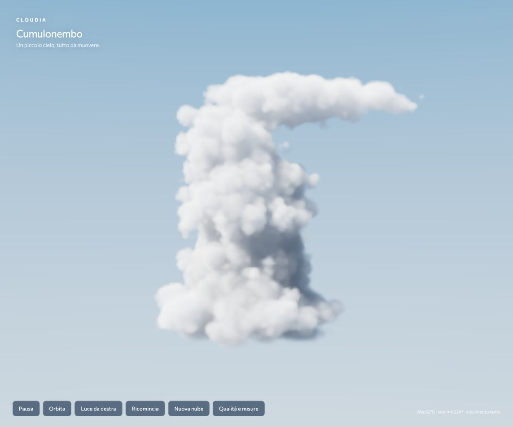
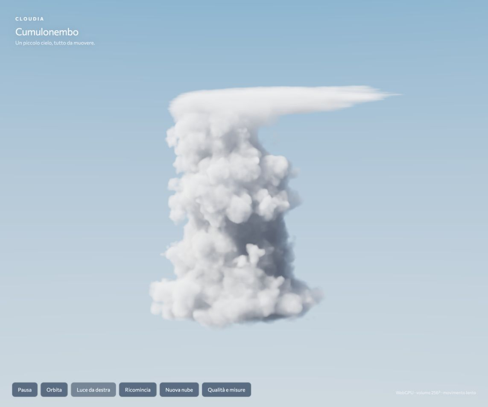
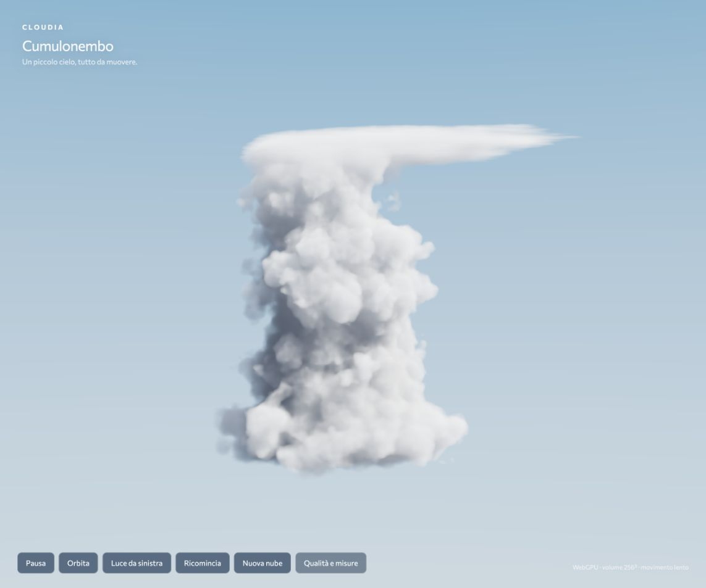

# Cumulonimbus refinement — real images and sustained measurements

11 October 2026. Local only. Production preview used `http://127.0.0.1:4176/?seed=1571198069`.

## What changed

The 256³ macro volume now includes smaller nested convective lobes and a flatter, asymmetric ice anvil. A periodic 64³ RGB field supplies fine cellular erosion and bounded domain displacement. Ice erosion is stretched horizontally and compressed vertically to distinguish the anvil from the cauliflower tower. The sun/sky caches are baked from this same eroded, displaced density; CPU generation, light transport and GPU interpolation share texel-center registration. The light balance has less fill and a gentler direct-light shoulder.

A conservative occupancy mask occupies the unused alpha channel of the detail texture. Max pooling and axis-specific dilation cover displacement plus the macro interpolation footprint. The shader first checks this mask, then evaluates fine density, then reads cached illumination. This prevents wasted detail lookups in empty sky while preserving outward displaced features. No lower resolution, TAA or adaptive quality was used. Massima is now 256 nominal steps; Alta remains 128, Fluida explicitly 75% / 96. Maximum loop length covers the world-box diagonal.

Meteorological reference: [NOAA glossary](https://www.weather.gov/otx/Glossary_of_Weather_Terms) and [NOAA cloud chart](https://www.weather.gov/media/bis/CloudChart.pdf). Their descriptions/images support the distinction between convective towers and the spreading ice anvil; this is an authored model, not a fluid or microphysical simulation.

## Images — same seed and camera

Previous renderer, sun left:

Refinement, sun left:

Refinement, sun right:

The anvil is thinner and wind-stretched, the tower has more broken contours and shadow structure. The scene still looks procedural in places: broad anvil patches are too smooth and the fill/atmosphere remains approximate. **Photographic-quality acceptance is still open; no owner visual acceptance is inferred.** Screenshots are compressed browser JPEGs, not exported photography. Orbit and both sun directions were inspected live, without console errors.

## Complete measurements, including slow runs

Chromium 155 in-app browser; AMD GCN-5 hardware WebGPU adapter, host Radeon Pro Vega 56. Every cloud run below uses seed 1571198069 and output/internal 1920×1080. Two-second warmup, scene visible, controls unchanged, panel closed during sampling. No builds or edits during the measured intervals. User confirmed pausing backup/sync; those applications were not controlled by the agent.

| Version | Seconds | RAF fps | p95 / p99 ms | Max ms | Intervals >33.34 ms | GPU mean / p95 ms |
|---|---:|---:|---:|---:|---:|---:|
| Previous 224³ / 192-step baseline | 90 | 59.30 | 17.6 / 17.7 | 365.8 | 7 | 1.824 / 2.032 |
| Opaque-renderer probe, previous scene | 30 | 35.28 | 57.3 / 78.2 | 120.7 | 289 | 1.965 / 2.032 |
| New detail, no conservative skip | 90 | 42.22 | 34.5 / 35.5 | 500.0 | 696 | 9.115 / 9.568 |
| Conservative skip, development server | 90 | 59.20 | 18.6 / 18.8 | 250.0 | 25 | 3.827 / 3.932 |
| **Production, sun left, slow orbit** | **90** | **59.98** | **18.6 / 18.8** | **18.9** | **0** | **3.808 / 3.932** |
| **Production, sun right, slow orbit** | **90** | **59.98** | **18.5 / 18.7** | **18.9** | **0** | **3.845 / 3.932** |

The production runs each recorded 5,399 frame intervals. CPU submission mean/p95 was 0.249 / 0.300 ms (left), 0.211 / 0.300 ms (right). The observed 60 Hz RAF cadence was sustained in both 90-second tests without missed-refresh-length intervals. RAF is callback/draw-submission cadence, not compositor-presented-frame certification. **120 fps and sustained performance across other seeds/devices are unmeasured.**

The GPU reduction from 9.115 to 3.827 ms supports the empty-space optimization. The cadence difference between development and production also includes evolving system load: do not attribute every stall or gain exclusively to Vite. A later sanitized host reading showed 88.55% CPU idle, about 22 GB used and 10 GB unused; earlier readings showed active backup/screen sharing and much higher load. The opaque renderer experiment was reverted: it was inconclusive under changing host load and did not yield an observed gain.

Raw reports contain all intervals and GPU/CPU samples:

- [Baseline](benchmarks/2026-10-11-refinement-baseline-1080p-90s.json)
- [Opaque probe](benchmarks/2026-10-11-refinement-opaque-probe-1080p-30s.json)
- [Detail before skip](benchmarks/2026-10-11-refinement-before-skip-1080p-90s.json)
- [Skip on dev server](benchmarks/2026-10-11-refinement-skip-dev-1080p-90s.json)
- [Production left](benchmarks/2026-10-11-refinement-production-left-1080p-90s.json)
- [Production right](benchmarks/2026-10-11-refinement-production-right-1080p-90s.json)

## Checks and next step

32 tests / 10 files pass, typecheck passes, application and legacy hero production builds pass. Bundler still warns about the large Three.js chunk. Read-only reviews found and verified fixes for displaced support clipping and CPU/GPU sampling misregistration; final occupancy review found no blockers. Review is a code gate, not visual acceptance.

Keep the current visual version available for owner inspection. Refine the remaining smoothness/light if needed before gestures. Later hand inference must use a separate rate budget rather than running a full model on every draw. No camera access or online deployment in this checkpoint.

Restart: `npm run dev`; open `/?seed=1571198069`. For comparable production measurements, `npm run build` then `npm run build:hero` then `npm run preview`; choose Massima and 1920×1080, enable orbit, run 90 seconds without builds, resizing or changing controls. Preserve and report slow runs too.
